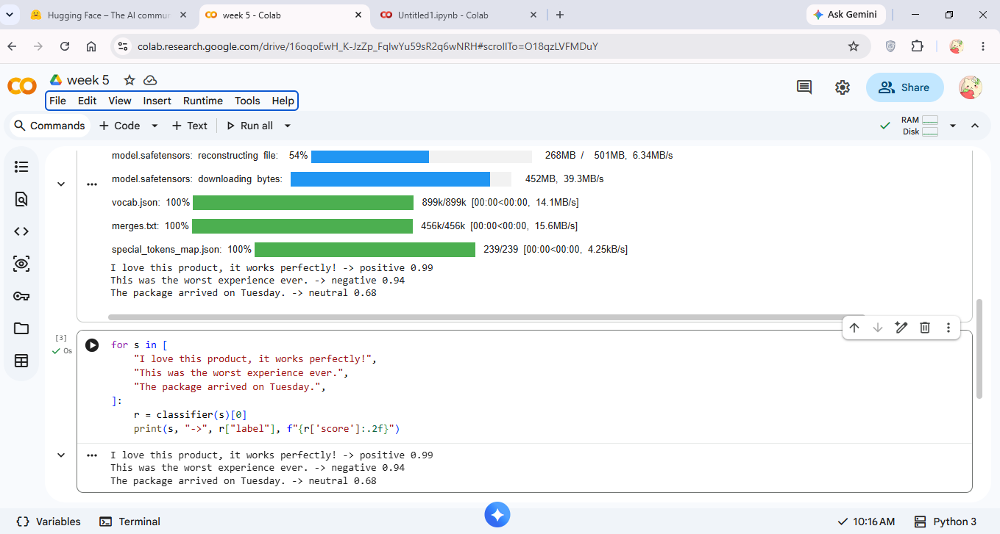
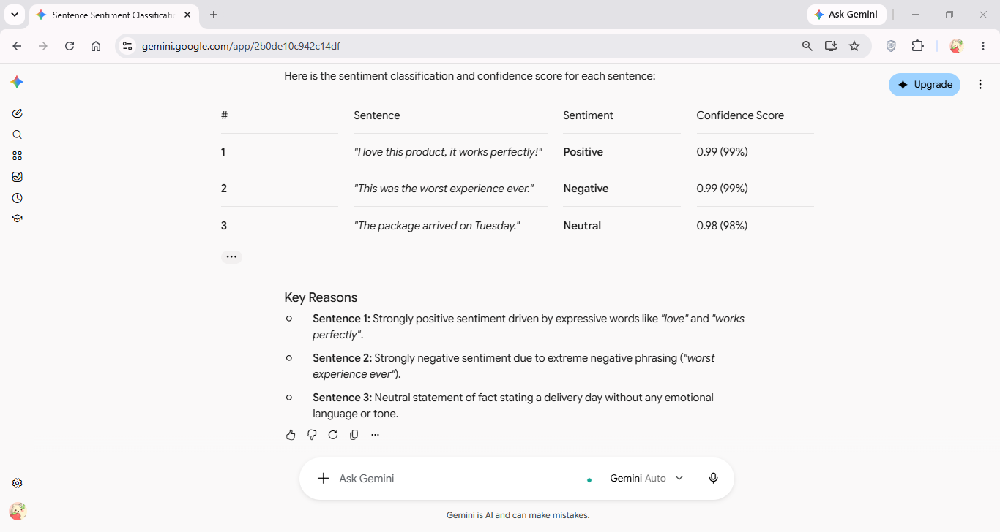

# Thursday: Open-source model vs proprietary model

I ran the same 3 sentences through both models. Open-source: `cardiffnlp/twitter-roberta-base-sentiment-latest` (run locally in Colab with `pipeline()`). Proprietary: Google Gemini.

| Sentence | Open-source (RoBERTa) | Proprietary (Gemini) |
|---|---|---|
| I love this product, it works perfectly! | Positive 0.99 | Positive 0.99 |
| This was the worst experience ever. | Negative 0.94 | Negative 0.99 |
| The package arrived on Tuesday. | Neutral 0.68 | Neutral 0.98 |

| Point | Open-source | Gemini |
|---|---|---|
| Accuracy | All 3 correct | All 3 correct |
| Confidence | Lower on the neutral sentence (0.68) | Very high on all |
| Extra detail | Label and score only | Also gave reasons |
| Speed | About 48 sec for the first download, then instant | Answer in seconds |
| Cost | Free | Free tier limited, API paid |
| Ease of use | Needs code, install and setup | Just type a prompt in chat |
| Control | Runs locally, data stays with me | Data goes to Google's servers |

## Observations

- Both models classified all 3 sentences correctly, so quality was equal in this small test.
- Gemini explained its reasoning, while RoBERTa only returned a label and score.
- Gemini's confidence scores are written by the model itself, not true probabilities. RoBERTa's scores are real model probabilities, so its 0.68 on the neutral sentence is the more honest number.
- The open-source model failed on the hosted Inference API (402 Payment Required, no credits), while Gemini worked immediately in chat.

## Conclusion

If you want quick results and explanations, Gemini is easier. If you want something free, private and under your control, the open-source model is the better choice.
